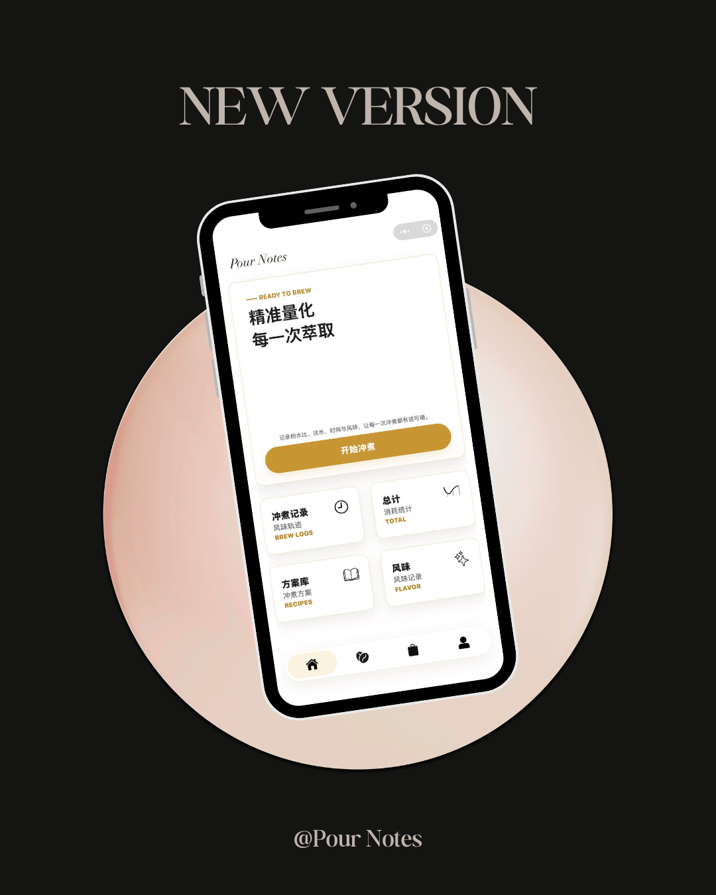
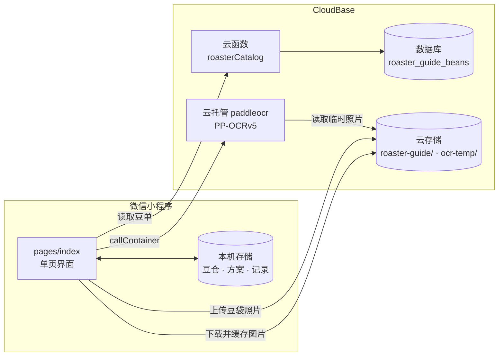

<div align="center">

# Pour Notes

**精准量化每一次萃取**

一个记录手冲咖啡的微信小程序：照着方案分段计时，把每一杯的参数和风味留下来。


[功能](#功能) · [架构](#架构) · [快速开始](#快速开始) · [项目结构](#项目结构) · [部署](#部署) · [致谢](#致谢)

<br>


&nbsp;


</div>

## 功能

- ⏱️ **分段冲煮计时**：按方案逐段推进，每段显示目标水量与时长，段落切换和结束时有提示音。
- 📖 **方案库**：内置 17 套方案，包括 2017–2026 年的 8 套 WBrC 冠军方案、粕谷哲 4:6、James Hoffmann、Scott Rao 和烘焙商官方建议；也可以自建方案并逐段调整。
- 📝 **冲煮记录**：每一杯保存豆子、方案参数、结果评价和风味，方便回看对比。
- 🫘 **豆仓**：管理在库和空袋的豆子，统计消耗量。
- 📷 **拍照识别豆袋**：拍一张豆袋标签，自动填好名称、处理法、风味、烘焙日期和重量，支持中英文混排。
- 🧭 **寻豆指南**：收录 24 家烘焙商的 176 款豆子，可按品种、处理法、产地国家筛选，豆单可在云端更新而无需发版。
- 🌸 **SCA 风味轮**：9 大类 84 个风味词，中英对照，也可以添加自己的风味词。
- 🔒 **数据只在本机**：不需要登录，豆仓、方案和记录都存在手机上；可导出 JSON 备份，再导入到新设备。

## 架构

小程序本身是一个单页应用，个人数据不上云。云端只负责两件事：分发寻豆指南的内容，以及识别豆袋照片。



豆袋照片只用于当次识别，请求结束后小程序会从 `ocr-temp/` 删除它。

## 快速开始

1. 克隆仓库。

   ```bash
   git clone https://github.com/chaoz-22/pour-notes.git
   ```

2. 用[微信开发者工具](https://developers.weixin.qq.com/miniprogram/dev/devtools/download.html)导入仓库根目录，基础库选 `latest`。不需要构建 npm。
3. 编译即可使用计时、方案库、冲煮记录、豆仓和风味轮，这些功能不依赖云端。

寻豆指南、拍照识别和滤杯图片需要云端资源。换成自己的环境时，修改 [`project.config.json`](project.config.json) 中的 `appid` 和 [`data/cloud-config.js`](data/cloud-config.js) 中的环境 ID，再按[部署](#部署)一节配置。

## 项目结构

按维护内容分类，改哪一类就看哪一行。

| 分类 | 路径 | 什么时候改 |
| --- | --- | --- |
| 小程序界面 | `pages/index/`、`templates/`、`app.js`、`app.json`、`app.wxss` | 改页面、交互、样式。所有功能都在 `pages/index` 单页内 |
| 内置数据 | `data/roasters.js`、`data/roaster-beans.js`、`data/preset-recipes.js`、`data/sca-flavors.js`、`data/audio-assets.js` | 增删烘焙商、豆单、预设方案、风味词、提示音 |
| 界面图标 | `assets/icons/` | 随代码包发布的图标与分享封面 |
| 云端内容图片 | `assets/roasters/`、`assets/bean-thumbnails-jpg/`、`assets/drippers/`、`assets/buying-guide/` | 不进代码包，需手动上传到云存储 `roaster-guide/`，路径与本地一致 |
| 云端豆单 | `cloudfunctions/roasterCatalog/`、`cloud-data/`、`scripts/export-roaster-catalog.js` | 改豆单读取逻辑，或重新生成数据库导入文件 |
| 拍照识别 | `cloudrun/paddleocr/`、`data/bean-ocr-cloud.js`、`data/bean-ocr-parser.js`、`scripts/test-bean-ocr-parser.js`、`scripts/paddleocr-smoke-test.py` | 改识别服务或字段解析规则 |
| 端侧 OCR（已停用） | `ocr/`、`scripts/strip-miniprogram-sourcemaps.sh` | 旧的 Paddle.js 方案，仅留档，不参与打包 |
| 工程配置 | `project.config.json`、`data/cloud-config.js`、`sitemap.json`、`package.json` | 改打包排除规则、云环境 ID、服务名、版本号 |
| 文档与预览图 | `README.md`、`docs/CLOUD_SETUP.md`、`docs/PADDLE_OCR_SETUP.md`、`docs/screenshots/` | 更新说明或换预览图。`docs/` 已排除出代码包 |

### 常用脚本

修改内置豆单后，重新生成数据库导入文件：

```bash
node scripts/export-roaster-catalog.js
```

改完豆袋字段解析规则后，跑一遍解析测试：

```bash
node scripts/test-bean-ocr-parser.js
```

## 部署

| 文档 | 内容 |
| --- | --- |
| [CLOUD_SETUP.md](docs/CLOUD_SETUP.md) | 云存储图片上传、豆单数据库导入、云函数部署、整体验收 |
| [PADDLE_OCR_SETUP.md](docs/PADDLE_OCR_SETUP.md) | PaddleOCR 云托管部署、存储安全规则、隐私配置、常见错误 |

当前线上环境：AppID `wx1f76c922f2a6c522`，CloudBase 环境 `pour-notes-d8gg2pilacb585b96`。

<details>
<summary>未纳入仓库的本地文件</summary>

- `node_modules/`：只服务于已停用的端侧 OCR。`package.json` 没有声明这些依赖，重装需手动安装 `@paddle-js-models/ocr@4.1.1`、`@paddlejs/paddlejs-core@2.2.0`、`@paddlejs/paddlejs-backend-webgl@1.2.9`、`js-clipper@1.0.1`、`number-precision@1.6.0`、`d3-polygon@3.0.1`。
- `project.private.config.json`：微信开发者工具的个人本地设置。
- `paddleocr-cloudbase-v*.zip`：`cloudrun/paddleocr` 的部署包，只保留最新一版，与该目录内容一致。

</details>

## 致谢

- [PaddleOCR](https://github.com/PaddlePaddle/PaddleOCR) 与 [PaddlePaddle](https://github.com/PaddlePaddle/Paddle)：豆袋文字识别，Apache-2.0。
- [FastDeploy](https://github.com/PaddlePaddle/FastDeploy)：`ocr/runtime/` 中的 OpenCV 小程序运行时，Apache-2.0。
- [SCA / WCR Coffee Taster's Flavor Wheel](https://sca.coffee/research/coffee-tasters-flavor-wheel)：风味分类体系。
- 方案库中的冲煮方案归各位冲煮师和烘焙商所有；寻豆指南中的豆子信息与图片归各烘焙商所有。
